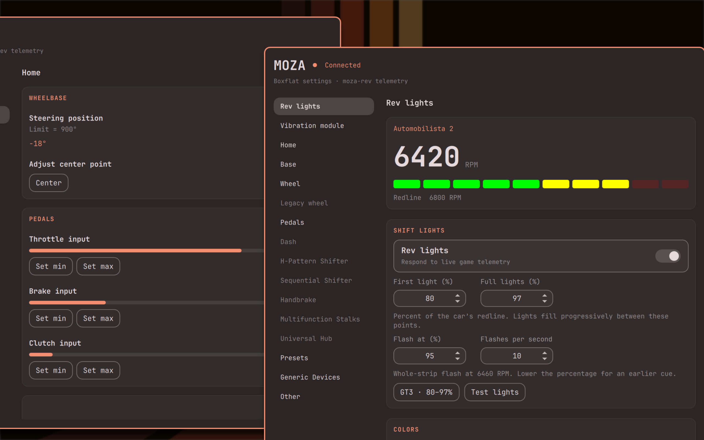

This release closes two ways for someone else to reach your wheel. Game
telemetry is now accepted only from this computer unless you opt in, and the
device rules give MOZA hardware to the user at the seat instead of every local
account. Rev lights, vibration and settings are otherwise unchanged from
[0.4.1](https://github.com/crmne/omarchy-moza/releases/tag/v0.4.1).

Download the [Linux x86-64 plugin archive](https://github.com/crmne/omarchy-moza/releases/download/v0.5.0/omarchy-moza-0.5.0.tar.gz).
The bundled executables are built twice in a pinned environment and verified
before publication. The release includes their checksums and build provenance.

## New

- **Telemetry from another PC is a choice you make.** To drive the wheel from
  a game running on another computer, add `telemetry-from-network: true` to
  `~/.config/omarchy-moza/settings.yml`, then disable and re-enable the
  plugin. The Wreckfest 2, Codemasters, AMS2 / Project CARS 2, BeamNG and
  Forza ports then listen on every interface. It is off by default. By @crmne.

## Fixed

- **Hosts on your network can no longer drive the rev lights or vibration.**
  The game telemetry ports listened on every network interface, and game
  telemetry has no authentication, so any host that could reach them could
  light the wheel and, with the vibration module enabled, vibrate the pedals.
  They now listen on `127.0.0.1`. Games on this computer that send to
  `127.0.0.1`, as the setup instructions use, keep working; the AMS2
  broadcast workaround in the README already redirects there.
  By @crmne; thanks [HANCORE-linux](https://github.com/HANCORE-linux) for
  the report.
- **Other accounts on the computer can no longer open your MOZA devices.**
  Setup installed Boxflat's device rule, which made every MOZA serial device
  writable by every local user. Setup now installs the plugin's own rule,
  which grants access only to the user signed in at the seat. If a
  `99-boxflat.rules` with a world-writable mode is installed, from an earlier
  version of this plugin or from Boxflat, the panel asks you to run setup
  again when the plugin next starts, and setup overrides it.
  By @crmne; thanks [HANCORE-linux](https://github.com/HANCORE-linux) for
  the report.

## Known limitations

- The network setting has no switch in the panel yet; edit `settings.yml`.
- After setup replaces the old rule, reconnect your MOZA devices (or restart)
  so their device nodes lose the old permissions.
- Rev lights and vibration from another PC rely on that network being
  trusted, since game telemetry cannot be authenticated.
- The [0.4.0 notes](https://github.com/crmne/omarchy-moza/releases/tag/v0.4.0)
  describe the vibration module, ACC / Le Mans Ultimate helper and game
  limitations, which are unchanged. ARM64 needs a source build.

## Thanks

- [HANCORE-linux](https://github.com/HANCORE-linux) found both issues during
  the Omarchy plugin marketplace review.
- @crmne implemented the fixes and regression tests.

**Full changelog**: https://github.com/crmne/omarchy-moza/compare/v0.4.1...v0.5.0
